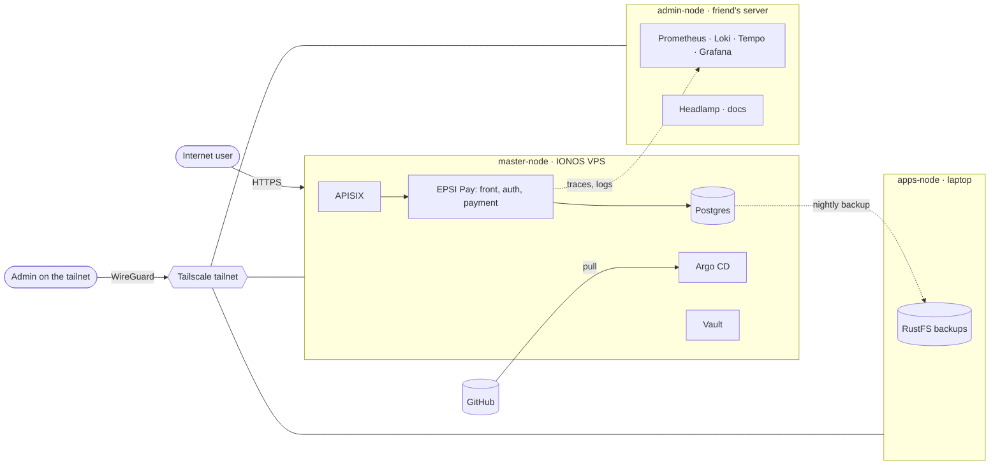

# How it works

The platform behind **EPSI Pay**, a small payment application with passkey login and AI-assisted
attack detection: what runs where, how the parts talk to each other, and which technologies do what.

Repositories: `RESILIENCE-ALPHA/infra` (platform) and `RESILIENCE-ALPHA/epsi_pay` (application) ·
Cluster: k3s v1.35, three nodes · Updated: November 2026

---

## The platform in one paragraph

Three machines form one **k3s** Kubernetes cluster: an **IONOS VPS** (the control plane, the public
edge and the application), a **friend's server** (`admin-node`, the observability and admin tools)
and an old **Windows laptop in WSL2** (`apps-node`, the backups). They talk over a **Tailscale**
private network (WireGuard), so none of them needs an open port to the others. Everything inside
the cluster is declared in Git and applied by **Argo CD**: this is **GitOps**. The machines are
configured by **Ansible**, the DNS records by **Terraform**. Every change goes through a pull
request checked by **GitHub Actions**. Secrets live in **Vault** and reach the pods through the
**External Secrets Operator**. Public traffic enters through the **APISIX** gateway; admin tools are
only reachable on the private tailnet. Database changes are versioned **Prisma migrations**, run
by Argo CD before each new version starts.



---

## Key ideas and vocabulary

| Term | Meaning here |
| --- | --- |
| **Infrastructure as Code (IaC)** | Servers, DNS and cluster content are described in files kept in Git, not configured by hand. |
| **GitOps** | Git is the single source of truth for what runs in the cluster. Argo CD pulls Git and makes the cluster match it. Nobody runs `kubectl apply` by hand. |
| **Declarative** | We describe the desired state ("1 replica of X, image tag Y"), not the steps. The tool works out the steps. |
| **Reconciliation loop** | A controller compares desired and live state and fixes the difference, again and again. Kubernetes and Argo CD both work like this. |
| **Drift / self-heal** | A manual change in the cluster is *drift*; Argo CD shows it as *OutOfSync* and reverts it. |
| **Prune** | Argo CD deletes what was removed from Git. Data objects (volumes, namespaces) are protected with `Prune=false`. |
| **App of apps** | A root Argo CD Application (`gitops/root.yaml`) whose content is all the other Applications (`gitops/apps/`). Adding a file there deploys a component. |
| **Sync wave / hook** | Ordering of a sync: namespaces first, then secrets, then apps. A **PreSync hook** runs before anything else (our database migrations). |
| **Migration** | A versioned SQL change of the database schema, generated by Prisma and applied once, in order, never deleting data by itself. |
| **Control plane / worker** | The control plane runs the Kubernetes API and decides where pods go; workers run pods. |
| **Taint / toleration / nodeSelector** | A taint keeps pods off a node unless they tolerate it; a nodeSelector sends a pod to nodes with a label. That is how admin tools land on `admin-node` and backups on `apps-node`. |
| **CNI / overlay network** | Gives each pod an IP and connects pods across nodes (Flannel, VXLAN). |
| **Service / ClusterIP** | A stable virtual IP and DNS name in front of a set of pods. |
| **Gateway API / HTTPRoute** | The standard way to describe HTTP routing (host, path → Service). APISIX implements it. |
| **Zero trust / least privilege** | Nothing is trusted because it is "inside": default-deny network policies, admin tools only on the tailnet, a secrets store with policies. |
| **Seal / unseal** | Vault keeps its data encrypted; after a restart it is *sealed* until 3 of 5 key shares open it (done automatically by `vault-unsealer`). |
| **Observability** | Metrics (Prometheus), logs (Loki), traces (Tempo), dashboards (Grafana), alerts (Alertmanager → Discord). |
| **RPO / RTO** | How much data we can lose (one night: backups are nightly) and how long a restore takes (25 s for Postgres, tested). |

---

## Machines (nodes)

| | VPS `master-node` (`ubuntu`) | Friend's server `admin-node` | Laptop `apps-node` |
| --- | --- | --- | --- |
| Role | k3s **server** (control plane) + workloads | k3s **agent** | k3s **agent** |
| Machine | IONOS classic VPS, Ubuntu 24.04 | KVM VM, Debian 13, 2 vCPU, 7.8 GB, 79 GB | Windows laptop, Ubuntu 24.04 in **WSL2** |
| Tailnet IP | `100.107.194.25` | `100.71.130.76` | `100.105.193.72` |
| Public IP | `85.215.234.70` | none needed | none (home NAT) |
| Taint | none | `node-role/admin=true:NoSchedule` | `location=home:NoSchedule` |
| Runs | public edge, EPSI Pay, Postgres, Vault, Argo CD, Falco, IA, Tailscale proxies | Prometheus, Alertmanager, Loki, Tempo, Grafana, Headlamp, this site | RustFS (backups) |
| Configured by | Ansible `hardening.yml`, `k3s.yml` | Ansible `k3s.yml` (no hardening: the owner's machine) | Ansible `k3s.yml`; WSL kept alive by a Windows task |

Every node also runs the per-node agents: Promtail (logs) and node-exporter (metrics).

If the **laptop** is off, the app keeps working; backups wait. If **admin-node** is off, the app keeps
working but monitoring and alerting stop, so an external uptime check is the safety net. If the **VPS** is
down, everything public is down (single control plane, accepted for now).

```bash
kubectl get nodes -o wide
kubectl get pods -A -o wide --sort-by=.spec.nodeName
```

---

## Networks: who talks over what

Seven layers; the **Live diagram → Networks** view shows each one.

### Internet (public)

- **Cloudflare DNS** (Terraform) points `app`, `auth`, `payment` to `85.215.234.70`, not proxied.
- The **IONOS firewall** and **ufw** on the VPS allow only TCP 22 (keys only, fail2ban), 80/443 and
  UDP 41641 (Tailscale). The Kubernetes API (6443) is **not** public.

### Tailnet (Tailscale, WireGuard)

- A mesh between the three nodes, the admins' devices and the admin-tool proxies. Addresses in
  `100.64.0.0/10`, names in `taild095e0.ts.net` (**MagicDNS**).
- Devices connect peer to peer (UDP 41641, NAT traversal), or through a **DERP** relay, still
  end-to-end encrypted. This is why the laptop (home NAT) and the friend's server need no open port.
- k3s uses it for everything between nodes: API on `100.107.194.25:6443`, Flannel over `tailscale0`.

### Host networks

Each machine's own network: the VPS's public interface, the friend's network (its owner reaches it
through **Teleport**), the laptop's WSL2 network behind Windows and the home router. The cluster
rides on the tailnet above them.

### Pod network (Flannel VXLAN)

- Every pod gets an IP in `10.42.0.0/16`, one `/24` per node: `10.42.0` VPS, `10.42.1` laptop,
  `10.42.2` admin-node.
- Across nodes, Flannel wraps the packet in **VXLAN** (UDP 8472) addressed to the other node's
  **tailnet** IP, and WireGuard encrypts that. Cross-node pod traffic is encrypted end to end.
- `flannel_watchdog` (systemd timer, every node) restarts k3s if `flannel.1` disappears;
  the `FlannelTunnelMissing` alert reports it.

### Service network (ClusterIP + DNS)

Services get a virtual IP in `10.43.0.0/16`; kube-proxy rewrites it to a pod IP, on whichever node
the pod runs. CoreDNS resolves `<service>.<namespace>.svc.cluster.local`.

### Network policies

Namespace `applications` is **default-deny** for incoming traffic. Allowed:

| To | From | Port |
| --- | --- | --- |
| front, auth, payment | APISIX gateway pods | 8080 / 3000 |
| auth, payment | front | 3000 |
| postgres | auth, payment, pgAdmin, backup, seed and **migrate** jobs, `service-ia` | 5432 |
| pgAdmin | Tailscale proxy namespace | 80 |

### Edges

- **Public:** ServiceLB holds ports 80/443 on the VPS → **APISIX** (TLS from Let's Encrypt via
  cert-manager, routing, plugins).
- **Admin:** the **Tailscale operator** turns each `Ingress` of class `tailscale` into a proxy pod
  that joins the tailnet with its own HTTPS name. The proxies run on the VPS and forward to the tool
  wherever it runs (Grafana on admin-node, for example).

---

## What runs in the cluster

| Namespace | Component | Node | Role |
| --- | --- | --- | --- |
| `argocd` | **Argo CD** | VPS | GitOps engine: pulls Git, applies it, reports health and drift. |
| `apisix` | **APISIX** + etcd + controller | VPS | Public API gateway, TLS, routing, plugins. |
| `applications` | **front** | VPS | React web app (nginx, port 8080). |
| `applications` | **auth** | VPS | Sign-up, login, sessions, **passkeys** (NestJS, port 3000). |
| `applications` | **payment** | VPS | Wallets and payments, passkey confirmation (NestJS, port 3000). |
| `applications` | **Postgres 16** | VPS | EPSI Pay database. |
| `applications` | **epsi-pay-migrate** (Job) | VPS | Prisma migrations, before every rollout (PreSync hook). |
| `applications` | **pgAdmin** | VPS | Database UI (tailnet only). |
| `ia` | **service-ia**, **Ollama** | VPS | AI analysis of Falco events and remediation; local LLM. |
| `security` | **Vault**, **vault-unsealer** | VPS | Secrets store, auto-unsealed. |
| `security` | **External Secrets**, **cert-manager** | VPS | Vault → Kubernetes Secrets; Let's Encrypt certificates. |
| `security-apps` | **Falco** + falcosidekick | VPS | Runtime threat detection (eBPF) → service-ia. |
| `admin` | **Prometheus**, **Alertmanager**, kube-state-metrics | admin-node | Metrics, 13 alert rules, Discord. |
| `admin` | **Loki** (+ gateway), **Promtail** | admin-node (+ every node) | Logs. |
| `admin` | **Tempo** | admin-node | Traces, service graph. |
| `admin` | **Grafana**, **Headlamp**, **docs-site** | admin-node | Dashboards, Kubernetes UI, this site. |
| `backup` | **RustFS** | laptop | S3 storage, target of every backup. |
| `tailscale` | **Tailscale operator** + proxies | VPS | Admin tools on the tailnet. |
| `kube-system` | CoreDNS, ServiceLB, local-path | VPS | k3s add-ons. |

---

## Main flows

Each one is animated in the **Live diagram** (Scenario buttons).

### A customer makes a payment

1. Cloudflare DNS → `85.215.234.70`; HTTPS through the IONOS firewall and ufw.
2. ServiceLB → **APISIX**, which terminates TLS and routes `/api/payments` to Service `epsi-pay-payment`.
3. The network policy lets APISIX in; kube-proxy picks a payment pod.
4. payment checks the **passkey signature** (when the user has one), then writes in **Postgres**.
5. APISIX (Zipkin) and payment (OTLP) send their spans to **Tempo** on admin-node, through the tunnel.

### An admin opens Grafana

1. On a tailnet device, `grafana.taild095e0.ts.net` resolves to the Grafana proxy (VPS).
2. WireGuard from the device into the proxy; the proxy forwards to Service `grafana`.
3. Grafana runs on admin-node: the packet crosses the overlay. Its queries to Prometheus, Loki and
   Tempo stay on admin-node.
4. From the internet, nothing: no DNS record, no route.

### A feature is shipped (GitOps)

1. Code + Prisma migration in a pull request on **epsi_pay**; merge → CI builds images `<date>.<run>`.
2. Pull request on **infra** bumping the image tags; CI validates; merge.
3. Argo CD sees the commit, runs the **migrate Job** (PreSync) → database up to date, then rolls out
   the new pods. Details: **Ship a feature**.

### A secret reaches a pod

1. The value is written once in **Vault** (`apps/...`), never in Git.
2. An `ExternalSecret` in Git names the Vault key and the Kubernetes Secret to create.
3. External Secrets logs in to Vault with its ServiceAccount (Kubernetes auth, read-only policy).
4. The pod reads the Secret as environment variables. k3s encrypts Secrets at rest.

### Nightly backups

| Time (Paris) | Job | What |
| --- | --- | --- |
| 02:30 | `postgres-backup` | `pg_dumpall` → gzip → RustFS |
| 02:45 | `k3s-backup` | online copy of the k3s datastore + integrity check |
| 03:00 | `vault-backup` | copy of Vault's data volume |

Each job runs on the VPS and uploads with **rclone** to RustFS on the laptop, across the tunnel.
90 days kept. Alerts if a job fails or the last backup is too old.

### An attack is detected

Falco (eBPF) spots suspicious behaviour → falcosidekick → **service-ia** → **Ollama** classifies it →
service-ia restarts the impacted pod through the Kubernetes API.

### Metrics, logs, alerts

Prometheus (admin-node) scrapes all three nodes; Promtail on each node pushes logs to Loki; Tempo
turns spans into a service graph; Grafana shows all three, linked. Alertmanager sends to Discord:
node not ready, disk almost full, Flannel tunnel missing, deployment unavailable, crash loop, Vault
sealed, backup too old or failed, certificate expiring, Argo CD app unhealthy or out of sync, target down.

---

## Technologies

| Technology | Category | What it is | Why here |
| --- | --- | --- | --- |
| **k3s** | Kubernetes distribution | Certified Kubernetes in one binary. | Small machines; built-in storage, load balancer, network policies. |
| **Kubernetes** | Orchestrator | Runs, restarts and connects containers. | One standard way to deploy everything. |
| **containerd** | Container runtime | Runs the containers on each node. | Standard runtime of Kubernetes. |
| **Flannel (VXLAN)** | CNI / overlay | Pod IPs, cross-node tunnel. | k3s default; runs over the tailnet. |
| **kube-router** | Network policies | Enforces NetworkPolicies (embedded in k3s). | Pod firewall without another CNI. |
| **CoreDNS** | DNS | Service discovery. | Standard. |
| **Tailscale** | Mesh VPN (WireGuard) | Private network with identity and NAT traversal. | Joins a VPS, a home laptop and a friend's server; keeps admin tools off the internet. |
| **Tailscale operator** | Kubernetes operator | Services on the tailnet with HTTPS. | Admin UIs reachable only by tailnet members. |
| **Teleport** | Access proxy | The friend's remote access to his server. | Used once, to install Tailscale on admin-node. |
| **Ansible** | Configuration management | Agentless, idempotent playbooks over SSH. | Tailscale, k3s, firewall, SSH hardening, watchdog. |
| **Terraform** + **HCP Terraform** | IaC provisioning | Declares cloud resources; remote state and runs. | Cloudflare DNS records. |
| **Cloudflare** | DNS | Authoritative DNS for `karim-portfolio.xyz`. | API for Terraform. |
| **Argo CD** | GitOps controller | Syncs manifests from Git, shows drift and health, runs hooks. | Git is the source of truth. |
| **Helm** / **Kustomize** | Packaging | Templated charts / plain YAML composition. | Third-party software / our own manifests. |
| **GitHub Actions** | CI | Checks on every pull request; image builds. | Lint, schema validation, Terraform plan; images on merge. |
| **GHCR** | Registry | GitHub's container registry. | EPSI Pay images, tagged `<date>.<run>`. |
| **APISIX** | API gateway | NGINX + Lua gateway, Gateway API. | TLS, routing, auth and tracing at the edge. |
| **cert-manager** + **Let's Encrypt** | Certificates | Automated ACME certificates. | HTTPS on the public sites. |
| **Vault** | Secrets manager | Encrypted store with policies and auth methods. | One place for every secret. |
| **External Secrets Operator** | Operator | Vault → Kubernetes Secrets. | Pods use normal Secrets. |
| **Prisma** | ORM + migrations | Schema, client and versioned SQL migrations. | Schema changes reach production safely. |
| **NestJS** / **React** | App frameworks | Node.js APIs / web front. | EPSI Pay. |
| **WebAuthn (passkeys)** | Strong authentication | Fingerprint / face verified on the device; only a signature is sent. | Passwordless login and payment confirmation. |
| **PostgreSQL** | Database | Relational database. | EPSI Pay data. |
| **Falco** | Runtime security | Suspicious behaviour from kernel events (eBPF). | Feeds the AI remediation. |
| **Ollama** | LLM runtime | Open models, locally. | Attack analysis without a cloud AI. |
| **Prometheus** / **Alertmanager** | Metrics & alerts | Time series + rules / routing. | Monitoring, Discord alerts. |
| **Loki** / **Promtail** | Logs | Label-indexed log store / shipper. | Logs of the three nodes. |
| **Tempo** / **OpenTelemetry** | Traces | Trace store / instrumentation standard. | One request across APISIX, auth, payment. |
| **Grafana** | Visualization | Dashboards and exploration. | One UI for metrics, logs, traces. |
| **Headlamp** / **pgAdmin** | UIs | Kubernetes UI / PostgreSQL UI. | Visual administration. |
| **RustFS** + **rclone** | Object storage + sync | S3-compatible store / copy tool. | Backups off the VPS. |
| **ufw** / **fail2ban** | Host firewall / IPS | iptables front-end / bans on failed logins. | VPS protection. |

---

## Security measures in place

- Admin tools (Argo CD, Grafana, Headlamp, Vault UI, pgAdmin, this site) on the tailnet only; no public DNS for them.
- Public ports limited to 80/443 (+22 keys-only, +41641/udp); fail2ban.
- Default-deny network policies in `applications`.
- Secrets in Vault; External Secrets with Kubernetes auth (read-only); the Headlamp admin token in
  `admin/`, outside what External Secrets can read.
- Kubernetes Secrets encrypted at rest; Vault unseal keys and root token kept offline by the owner.
- Passkeys (WebAuthn): passwordless login, and payments signed on the device once a passkey exists.
- Falco runtime detection; alerts to Discord.
- Nightly backups off the VPS, restore tested.
- Every change through a reviewed pull request with CI; database changes as versioned migrations.

---

## Repository map

```
infra/
  terraform/            Cloudflare DNS (HCP Terraform workspace infra-dns)
  ansible/              Nodes: playbooks k3s.yml, hardening.yml, argocd.yml
  gitops/root.yaml      Root Argo CD app (app of apps)
  gitops/apps/          One Argo CD Application per component
  kubernetes/           Manifests and Helm values, one folder per area
  kubernetes/docs-site/ This site (Markdown pages + animated diagram)
  .github/workflows/    CI: lint + manifest validation, Terraform plan/apply

epsi_pay/
  auth/ payment/ front/ Application services
  database/prisma/      schema.prisma, migrations/, seed, migrate.ts
  .github/workflows/    Image builds on every merge to master
```
