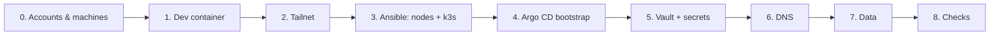

# Installation

How to build the platform from zero (new machines, or a rebuild after a disaster), and how to add a
node. Everything is in Git: the steps below only create the machines' base, the secrets and the
data, which are deliberately **not** in Git.

> **Where each command runs.** 💻 *dev container* (VS Code, in the `infra` repo) ·
> 🖥️ *VPS* (`ssh root@100.107.194.25`, over the tailnet) · 🌐 *a web console*.
> Never paste a token, key or password into a chat, a ticket or Git: type secrets with `read -rs`.



---

## 0. What you need

**Accounts**

| Service | Used for | Owner |
| --- | --- | --- |
| GitHub org `RESILIENCE-ALPHA` | repos `infra`, `epsi_pay`; CI; GHCR images | Karim + members |
| Tailscale (tailnet `taild095e0.ts.net`) | private network between nodes and admins | Karim |
| Cloudflare | DNS of `karim-portfolio.xyz` | Karim |
| HCP Terraform org `resilience-alpha` | Terraform state and runs (workspace `infra-dns`) | Karim |
| Discord | alert channel webhook | team |

**Machines**

| Node | Minimum | OS |
| --- | --- | --- |
| Control plane (VPS) | 4 vCPU, 8 GB RAM, 100 GB SSD, public IPv4 | Ubuntu 24.04 |
| admin-node | 2 vCPU, 8 GB RAM, 60 GB | Ubuntu or Debian (x86 or ARM) |
| apps-node (backups) | 2 vCPU, 4 GB RAM, 250 GB disk | Ubuntu 24.04 (WSL2 works) |

Root or passwordless sudo over SSH, outbound internet. No inbound port is needed on the workers.

---

## 1. Dev container (your computer)

Install **VS Code**, **Docker** and the **Dev Containers** extension, then:

```bash
git clone https://github.com/RESILIENCE-ALPHA/infra.git
code infra        # "Reopen in Container"
```

The container has kubectl, Ansible, Terraform, kustomize, kubeconform and the linters. Nothing else
is installed on your computer.

---

## 2. Tailnet

1. 🌐 Tailscale admin console: create the tailnet (once), invite the admins.
2. Install **Tailscale** on your computer and log in.
3. For each node, either let Ansible log it in with a one-time **auth key**
   (🌐 Settings → Keys → *Generate auth key*, set `tailscale_authkey` for that host, never commit it),
   or log it in by hand on the machine:
   ```bash
   curl -fsSL https://tailscale.com/install.sh | sh
   sudo tailscale up --hostname=<node-name> --ssh      # open the printed URL and approve
   tailscale ip -4
   ```
4. 🌐 Machines → each node → **Disable key expiry** (otherwise it leaves the tailnet after 180 days).

**WSL2 node only** (Windows laptop): enable systemd in `/etc/wsl.conf` (`[boot] systemd=true`), set
the hostname, and create a Windows scheduled task at logon running
`wsl.exe -d Ubuntu-24.04 --exec /bin/sleep infinity` (no time limit, restart on failure), so WSL
keeps running with no terminal open.

---

## 3. Nodes and k3s (Ansible)

### Inventory

💻 `cp ansible/inventory/hosts.yml.example ansible/inventory/hosts.yml` (gitignored) and fill it with
the **tailnet IPs**. Today's cluster:

```yaml
all:
  children:
    k3s_cluster:
      children:
        k3s_server:
          hosts:
            master-node:
              ansible_host: 100.107.194.25
              ansible_user: root
              k3s_node_external_ip: "85.215.234.70"
        k3s_agents:
          hosts:
            apps-node:
              ansible_host: 100.105.193.72
              ansible_user: karim
              k3s_node_labels: [location=home, hardware=laptop]
              k3s_node_taints: [location=home:NoSchedule]
            admin-node:
              ansible_host: 100.71.130.76
              ansible_user: ktrabelsi
              k3s_node_labels: [node-role/admin=true]
              k3s_node_taints: [node-role/admin=true:NoSchedule]
```

The k3s version and options are in `ansible/inventory/group_vars/` (`k3s_cluster.yml`, `k3s_server.yml`).

### Run

💻 in `ansible/`. Always a dry run first; `-K` asks the sudo password of nodes that need one (the laptop).

```bash
ansible-galaxy collection install -r requirements.yml
ansible all -m ping
ansible-playbook playbooks/hardening.yml --check --diff     # VPS only: ufw, SSH keys only, fail2ban
ansible-playbook playbooks/hardening.yml
ansible-playbook playbooks/k3s.yml --check --diff -K       # Tailscale, k3s server + agents, watchdog
ansible-playbook playbooks/k3s.yml -K
```

🌐 IONOS console → firewall policy of the VPS: allow TCP 22, 80, 443 and UDP 41641 only.

### kubectl from the dev container

```bash
mkdir -p ~/.kube
ssh root@100.107.194.25 cat /etc/rancher/k3s/k3s.yaml | sed 's/127.0.0.1/100.107.194.25/' > ~/.kube/config
chmod 600 ~/.kube/config
kubectl get nodes -o wide          # all nodes Ready, INTERNAL-IP = tailnet IPs
```

### Adding a node later

Same steps for one machine: Tailscale (step 2), add it to `hosts.yml` with its label and taint, then
`ansible-playbook playbooks/k3s.yml --limit <node> --check --diff` and without `--check`. Workloads
move to it by giving them a `nodeSelector` + `toleration` in Git (see *Operations → Move a tool to
another node*).

---

## 4. Argo CD bootstrap

💻 One playbook installs Argo CD and the root application; from then on Argo CD deploys everything
in `gitops/apps/` from Git, in sync-wave order (namespaces first).

```bash
cd ansible
ansible-playbook playbooks/argocd.yml --check --diff
ansible-playbook playbooks/argocd.yml
kubectl -n argocd get applications -w      # Ctrl+C when they settle
```

Apps that need secrets stay *Degraded* until step 5. That is expected.

---

## 5. Vault and the secrets

### Initialise and unseal (first install only)

```bash
kubectl -n security exec -it vault-0 -- vault operator init -key-shares=5 -key-threshold=3
```

It prints **5 unseal keys and the root token, once**. Store them in a password manager, **never** in
Git, a chat or Vault itself. Then unseal (3 different keys) and log in without printing the token:

```bash
kubectl -n security exec -it vault-0 -- vault operator unseal      # ×3
kubectl -n security exec -it vault-0 -- vault login -no-print
```

### Auto-unseal

```bash
read -rs K1; read -rs K2; read -rs K3
kubectl -n security create secret generic vault-unseal-keys \
  --from-literal=key1="$K1" --from-literal=key2="$K2" --from-literal=key3="$K3"
unset K1 K2 K3
```

From now on `vault-unsealer` reopens Vault within 30 s after any restart.

### Secret engines, policy and External Secrets login

```bash
V() { kubectl -n security exec -i vault-0 -- vault "$@"; }       # after vault login -no-print in the pod
V secrets enable -path=apps -version=2 kv
V secrets enable -path=admin -version=2 kv                     # admin-only secrets (Headlamp token)
V policy write external-secrets-read - <<'EOF'
path "apps/data/*"     { capabilities = ["read"] }
path "apps/metadata/*" { capabilities = ["read", "list"] }
EOF
V auth enable kubernetes
V write auth/kubernetes/config kubernetes_host="https://kubernetes.default.svc:443"
V write auth/kubernetes/role/external-secrets \
  bound_service_account_names=external-secrets bound_service_account_namespaces=security \
  policies=external-secrets-read ttl=1h
```

### The values

Every path and key the cluster reads. Create each with `vault kv put -mount=apps <path> key=value …`,
typing values with `read -rs`, or in the Vault UI (https://vault.taild095e0.ts.net).

| Vault path | Keys | Used by |
| --- | --- | --- |
| `apps/postgres` | `password` | Postgres superuser |
| `apps/postgres-epsi-pay` | `username`, `password`, `database` (`epsi_pay`), `host` (`postgres.applications.svc.cluster.local`), `port` (`5432`) | auth, payment, migrate, seed |
| `apps/ghcr-credentials` | `username`, `token` (GitHub token with `read:packages`) | image pulls |
| `apps/pgadmin` | `email`, `password` | pgAdmin login |
| `apps/swagger-basic-auth` | `username`, `password` | Swagger UIs behind APISIX |
| `apps/apisix-admin` | `key`, `viewer` | APISIX admin API |
| `apps/grafana` | `admin-user`, `admin-password` | Grafana login |
| `apps/alerting` | `discord_webhook` | Alertmanager → Discord |
| `apps/tailscale` | `oauth_client_id`, `oauth_client_secret` (Tailscale OAuth client, tag `k8s-operator`) | Tailscale operator |
| `apps/backup` | `rustfs_access_key`, `rustfs_secret_key` | RustFS and the three backup jobs |
| `admin/headlamp` | `token` | Headlamp login (not readable by External Secrets) |

Then force a refresh and check:

```bash
for es in $(kubectl get externalsecret -A -o jsonpath='{range .items[*]}{.metadata.namespace}/{.metadata.name}{" "}{end}'); do
  kubectl -n "${es%/*}" annotate externalsecret "${es#*/}" force-sync=$(date +%s) --overwrite >/dev/null; done
sleep 20; kubectl get externalsecret -A | grep -v SecretSynced || echo "all SecretSynced"
```

### Secrets encryption at rest (k3s)

🖥️ VPS: `k3s secrets-encrypt status` must say *Enabled*. Save `/var/lib/rancher/k3s/server/token`
and `/var/lib/rancher/k3s/server/cred/encryption-config.json` in the password manager: both are
needed to restore a k3s backup.

---

## 6. DNS (Terraform, HCP)

1. 🌐 Cloudflare: API token limited to the zone (*DNS Edit, DNS Read, Zone Read*).
2. 🌐 HCP Terraform, workspace `infra-dns`: environment variable `CLOUDFLARE_API_TOKEN`, **sensitive**.
3. 🌐 GitHub `infra` → Settings → Secrets: `TF_API_TOKEN` (HCP team token).
4. Any change under `terraform/` → pull request (plan in a comment) → merge (apply).

Locally (💻): `cd terraform && terraform login && terraform init && terraform plan`.

---

## 7. Data

- **New, empty platform:** the `epsi-pay-seed` app creates the demo data once (migrations, then the
  seed). Never re-run it on real data: below 5000 login attempts it **wipes** the tables.
- **Rebuild after a disaster:** restore the latest backups from RustFS (Postgres, Vault, k3s datastore),
  see *Operations → Backups and restore*.

---

## 8. Checks

```bash
kubectl get nodes -o wide
kubectl -n argocd get applications -o custom-columns=NAME:.metadata.name,SYNC:.status.sync.status,HEALTH:.status.health.status \
  | grep -v "Synced *Healthy" || echo "all Synced Healthy"
kubectl get pods -A | grep -vE 'Running|Completed' || echo "all pods Running"
kubectl get certificate -A
for h in app auth payment; do printf '%-8s ' $h; curl -s -o /dev/null -w '%{http_code}\n' https://$h.karim-portfolio.xyz; done
```

Then: a payment on https://app.karim-portfolio.xyz, the tailnet URLs (Grafana, Argo CD, Headlamp,
docs), a test alert to Discord (*Operations → Alerts*), and a first backup by hand.
