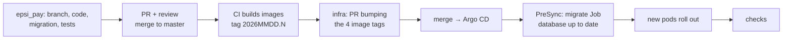

# Ship a feature (EPSI Pay)

Everything to run when a new feature goes from your laptop to production. Two repositories:
**`epsi_pay`** (the code, built into images) and **`infra`** (which image version runs). The
**Live diagram → Ship a feature** scenario animates the whole path.



---

## 1. Code it (epsi_pay)

```bash
git checkout master && git pull
git checkout -b feat/<short-name>
```

A local database with the production schema (Node 22, see `.nvmrc`):

```bash
docker run -d --name epsi-pg -e POSTGRES_USER=epsi_pay -e POSTGRES_PASSWORD=dev -e POSTGRES_DB=epsi_pay -p 5432:5432 postgres:16-alpine
cp .env.example .env            # DB_HOST=localhost, DB_PORT=5432, DB_USER=epsi_pay, DB_PASSWORD=dev, DB_NAME=epsi_pay
set -a; . ./.env; set +a        # export the variables to this terminal
cd database && npm ci && npm run build && npm run migrate && npm run seed && cd ..
```

Then run the services you touch, as described in their READMEs (`auth/`, `payment/`: `npm ci`,
`npm run prisma:generate`, `npm run start:dev`; `front/`: `npm run dev`, with `VITE_API_TARGET`
pointing to your API).

---

## 2. Database change? Write a migration

If you changed `database/prisma/schema.prisma`, generate the migration **against your local database**:

```bash
npm run prisma:migrate -- --name add_<what>       # from the repository root
git add database/prisma/schema.prisma database/prisma/migrations/
```

Read the generated `database/prisma/migrations/<timestamp>_add_<what>/migration.sql` before committing.

**Rules** (the migration runs *before* the new pods start, while the old version still serves):

| Do | Avoid in one step |
| --- | --- |
| Add tables, add nullable columns, add indexes | Drop or rename a column the running code uses |
| Add a column with a default | Make an existing column `NOT NULL` without a default |
| Rename in two releases: add new → copy → switch code → drop old | Edit an already-merged migration file |

Without a migration, the new code ships but its tables don't: the API answers **500**
(`P2021 table … does not exist`). The migrate step also warns when the database and
`schema.prisma` differ.

---

## 3. Test, then open the pull request

```bash
cd front && npm test && npm run typecheck && cd ..
npm --prefix auth run build && npm --prefix payment run build
git commit -m "feat(<service>): <what and why>"
git push -u origin feat/<short-name>
```

Pull request on `epsi_pay` → review → **merge to `master`**.

---

## 4. Get the new image tag

The merge starts **Actions → Build and push images**. It builds `auth`, `payment`, `front` and
`database` with **the same tag**, `<date>.<run number>` (e.g. `20261116.12`).

Find it in the run: job **version** → `tag=…`, or on the GHCR package page. Wait until all four builds
are green. Use the **real number**, never a placeholder: a tag that does not exist blocks the sync.

---

## 5. Deploy it (infra)

💻 dev container:

```bash
git checkout main && git pull
git checkout -b deploy/epsi-pay-<tag>
TAG=20261116.12        # the real tag
sed -i -E "/epsi-pay-(auth|payment|front|database)$/{n;s/newTag: \".*\"/newTag: \"$TAG\"/}" kubernetes/applications/kustomization.yaml
git diff               # 4 lines: the four images, same tag
git commit -am "EPSI Pay: deploy $TAG (<feature>)"
git push -u origin deploy/epsi-pay-$TAG
```

Also in this pull request, when the feature needs it:

| The feature needs… | Change in `infra` |
| --- | --- |
| a new environment variable | `kubernetes/applications/auth.yaml` / `payment.yaml` |
| a new secret | value in Vault `apps/<path>` + an `ExternalSecret` |
| a new public URL path | a rule in the `HTTPRoute` of the service (`auth.yaml`, `payment.yaml` or `front.yaml`) |
| a new pod reaching Postgres | its label in `allow-postgres-clients` (`network-policies.yaml`) |

Pull request → CI green → **merge**.

---

## 6. Watch the rollout

Argo CD runs the **migrate Job first** (PreSync hook), then the new pods.

```bash
kubectl -n argocd get app epsi-pay -o jsonpath='{.status.operationState.phase} | {.status.operationState.message}{"\n"}'
kubectl -n applications logs job/epsi-pay-migrate -c migrate        # "No pending migrations" or "applied", then "OK : aucun écart"
kubectl -n applications rollout status deploy/epsi-pay-auth deploy/epsi-pay-payment deploy/epsi-pay-front --timeout=180s
kubectl -n argocd get app epsi-pay                                   # Synced · Healthy
```

If it does not start within 3 minutes: `kubectl -n argocd annotate app epsi-pay argocd.argoproj.io/refresh=hard --overwrite`.

If the **migrate Job fails**, the sync stops and the **previous version keeps running**. Read its log,
fix in `epsi_pay`, ship a new tag. A sync stuck on an old commit: *Operations → Argo CD sync stuck*.

---

## 7. Check in production

1. Use the feature on https://app.karim-portfolio.xyz, with DevTools → Network open (no 4xx/5xx).
2. Logs:
   ```bash
   kubectl -n applications logs deploy/epsi-pay-auth --since=10m | grep -iE 'error|exception' | tail
   kubectl -n applications logs deploy/epsi-pay-payment --since=10m | grep -iE 'error|exception' | tail
   ```
3. Grafana → Explore → **Tempo**: `{resource.service.name=~"epsi-pay-.*" && status=error}` → nothing new.
4. Discord: no new alert.

---

## Rolling back

Revert the infra pull request (GitHub → *Revert*, merge): Argo CD redeploys the previous images.
Migrations are **not** undone: that is why they must stay compatible with the previous code (step 2).
If a migration itself was wrong, fix it **forward** with a new migration.

---

## Checklist

- [ ] Branch in `epsi_pay`, feature coded, tested locally
- [ ] Schema changed? Migration generated, reviewed, committed with the schema
- [ ] PR merged; four images built with the same tag
- [ ] `infra` PR: four tags (+ env vars, secrets, routes, network rules if needed); merged
- [ ] migrate Job OK, `epsi-pay` Synced · Healthy
- [ ] Feature works in production; no errors in logs, traces or Discord
