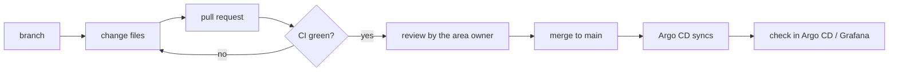

# How the teams work

Each team owns one part of the platform and changes it **only through pull requests**. Argo CD
applies what is merged; nobody edits the cluster by hand (self-heal reverts it within minutes).
The **Live diagram → Teams** view shows who owns which pod.

---

## Who owns what

| Team | Owns | Repository · folders | Argo CD apps |
| --- | --- | --- | --- |
| **Applications** | EPSI Pay: front, auth, payment, database schema | `epsi_pay` (all) · `infra/kubernetes/applications/` | `epsi-pay`, `postgres`, `epsi-pay-seed` |
| **IA** | service-ia, Ollama | service-ia's repo · `infra/kubernetes/ia/` | `ollama` |
| **Security** | Vault, External Secrets, cert-manager, Falco, network policies | `infra/kubernetes/security/` (incl. Falco values), `kubernetes/applications/network-policies.yaml` | `vault`, `security-config`, `external-secrets`, `cert-manager`, `falco` |
| **Observability** | Prometheus, alert rules, Alertmanager, Loki, Tempo, Grafana and its dashboards | `infra/kubernetes/logging/` | `prometheus`, `loki`, `promtail`, `tempo`, `grafana`, `logging` |
| **Platform** (Karim) | nodes, k3s, Argo CD, APISIX, Tailscale, backups, DNS, this site | `infra/ansible/`, `terraform/`, `gitops/`, `kubernetes/apisix/`, `tailscale/`, `backup/`, `docs-site/` | `root`, `argocd`, `apisix*`, `tailscale-operator`, `tailnet-admin`, `rustfs`, `namespaces`, `docs-site` |

Changes that cross areas (a new secret, a new route, a new network rule) are welcome from anyone:
the owner of the area reviews the pull request.

---

## Getting access (onboarding)

### Install

1. **Tailscale** (https://tailscale.com/download), then accept the invitation to the tailnet.
   Check: `tailscale status` lists `master-node`.
2. **Git** + a **GitHub** account in `RESILIENCE-ALPHA`.
3. **VS Code + Docker + Dev Containers** to work on `infra` (all tools are inside the container).
4. Optional, for command-line administration: **kubectl v1.35** and a kubeconfig from Karim
   (server `https://100.107.194.25:6443`, reachable on the tailnet only, file mode `600`).

### What you can open (tailnet only)

| Tool | Address | Login |
| --- | --- | --- |
| This site | https://docs.taild095e0.ts.net | none |
| Grafana | https://grafana.taild095e0.ts.net | Grafana account from Karim |
| Argo CD | https://argocd.taild095e0.ts.net | account from Karim (GitHub SSO planned) |
| Headlamp | https://headlamp.taild095e0.ts.net | a ServiceAccount token (Karim, or Vault `admin/headlamp`) |
| Vault UI | https://vault.taild095e0.ts.net | a personal token with a limited policy |
| pgAdmin | https://pgadmin.taild095e0.ts.net | pgAdmin account from Karim |

Public application: https://app.karim-portfolio.xyz

> Today the cluster has one admin identity; per-team accounts (namespace RBAC, Argo CD projects and
> SSO, per-team Vault policies) are the next security step. Ask for the least access you need.

### Rules

- Never paste tokens, passwords, keys or webhooks in chat, tickets or Git.
- Type secrets with `read -rs VAR`; log in to Vault with `vault login -no-print`.
- Never `kubectl apply/edit/scale` something Argo CD manages: change Git instead.

---

## The daily loop



```bash
git checkout main && git pull
git checkout -b feat/<short-name>          # or fix/…, docs/…
# … edit …
git add -p && git commit -m "<area>: what and why"
git push -u origin feat/<short-name>       # then open the PR on GitHub
```

**CI** (`lint` workflow) runs yamllint, actionlint, ansible-lint, and builds every Argo CD folder with
kustomize + kubeconform; `terraform` posts a plan for DNS changes. Fix what it reports before review.

**After merge**, watch your app become *Synced · Healthy*:

```bash
kubectl -n argocd get app <app>
kubectl -n argocd annotate app <app> argocd.argoproj.io/refresh=hard --overwrite   # if it does not move
kubectl -n <namespace> get pods -o wide
kubectl -n <namespace> logs deploy/<name> --since=10m
```

---

## Per team: the usual changes

### Applications team

- **Ship a feature:** see *Ship a feature* (code + migration in `epsi_pay`, then the image tags in `infra`).
- **New environment variable:** add it to `kubernetes/applications/auth.yaml` or `payment.yaml`;
  if it is a secret, put the value in Vault (`apps/<name>`) and map it with an `ExternalSecret`.
- **New public path:** a rule in the service's `HTTPRoute` (`auth.yaml`, `payment.yaml` or `front.yaml`: host + path → Service).
- **New service talking to Postgres:** add its `app` label to `allow-postgres-clients` in
  `network-policies.yaml` (the namespace is default-deny).

### IA team

- service-ia is built from its own repository; its manifests and Ollama's are in `kubernetes/ia/`.
- **Moving Ollama off the VPS** (to do): give the Deployment a `nodeSelector` + `toleration` for the
  target node, and plan its model volume (20 Gi): either re-download the models on the new node, or copy
  the volume like Grafana (*Operations → Move a tool to another node*). Check the target node has the RAM
  for the model (≈ model size + 1 GB).

### Security team

- **New secret:** value in Vault (`apps/<path>`), `ExternalSecret` next to the app that uses it.
  External Secrets reads `apps/*` only; admin-only secrets go to `admin/*`.
- **Network rules:** `kubernetes/applications/network-policies.yaml`; test with a pod carrying the
  client's label (`kubectl run … --labels=app=<label> -- nc -zv <service> <port>`).
- **Falco rules / outputs:** `kubernetes/security/falco-values.yaml` (events go to service-ia).

### Observability team

- **Alert rule:** `kubernetes/logging/prometheus-values.yml` → `serverFiles.alerting_rules.yml`.
  Test the route to Discord with a manual alert (*Operations → Alerts*).
- **Dashboard:** export the JSON from Grafana into `kubernetes/logging/dashboards/`, add it to the
  `configMapGenerator` of `kubernetes/logging/kustomization.yaml` with the label `grafana_dashboard: "1"`.
- **Data source:** `kubernetes/logging/grafana-values.yml` (keep the existing `uid`s: Grafana cannot change them).

### Platform

- **New component:** a file in `gitops/apps/` (Argo CD Application) + its manifests or Helm values.
- **Nodes:** Ansible (*Installation → Nodes and k3s*). **DNS:** `terraform/dns.tf`.
- **Admin tool on the tailnet:** an `Ingress` of class `tailscale` in `kubernetes/tailscale/access/`.

---

## When something breaks

| Symptom | First look |
| --- | --- |
| App *OutOfSync* for long | Argo CD UI → the app → *Diff*; `kubectl -n argocd get app <app> -o jsonpath='{.status.operationState.message}'` |
| App *Degraded* | `kubectl -n <ns> get pods`, then `describe pod` (Events) and `logs` |
| Sync stuck on a hook | *Operations → Argo CD sync stuck* |
| 500 errors | auth / payment logs; Grafana → Explore → Tempo, `status=error` |
| Secret missing | `kubectl get externalsecret -A` (must be *SecretSynced*), the Vault path and key names |
| Alert on Discord | the alert's summary names the object; Grafana → Explore → Loki / Prometheus |
